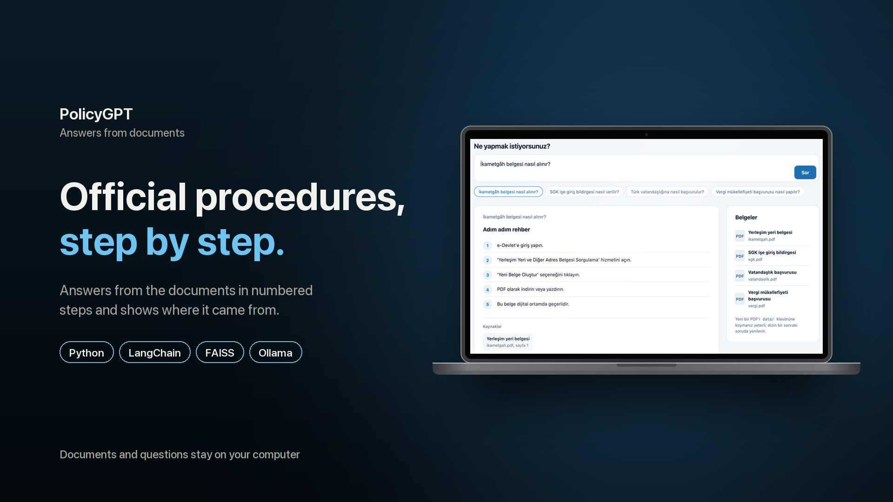
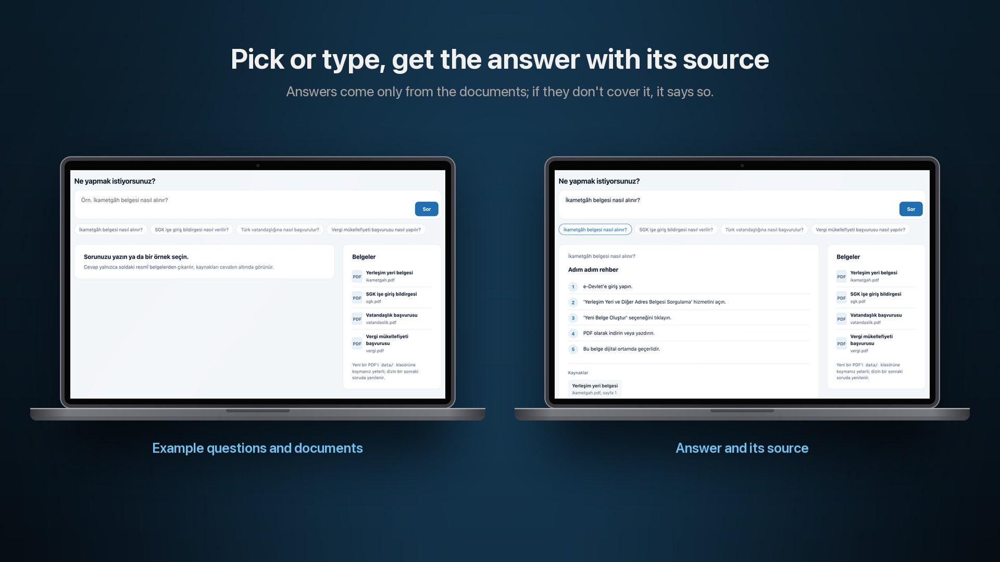
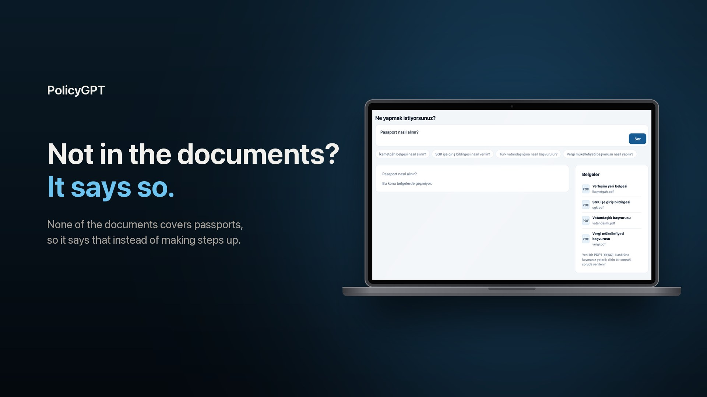
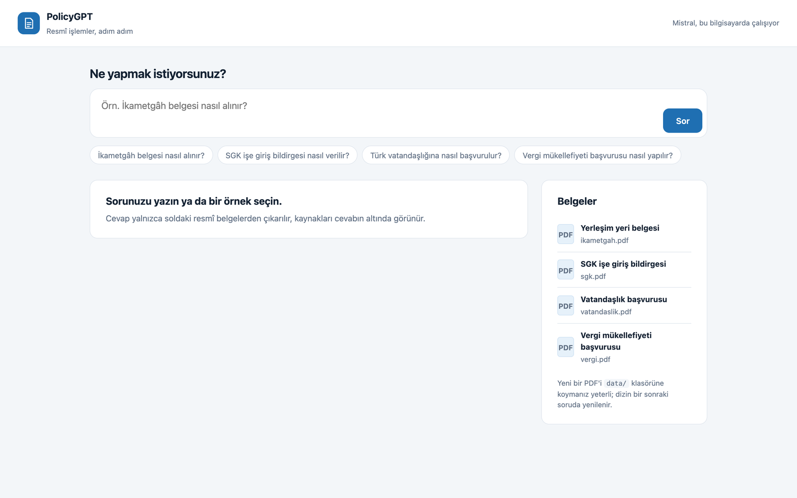
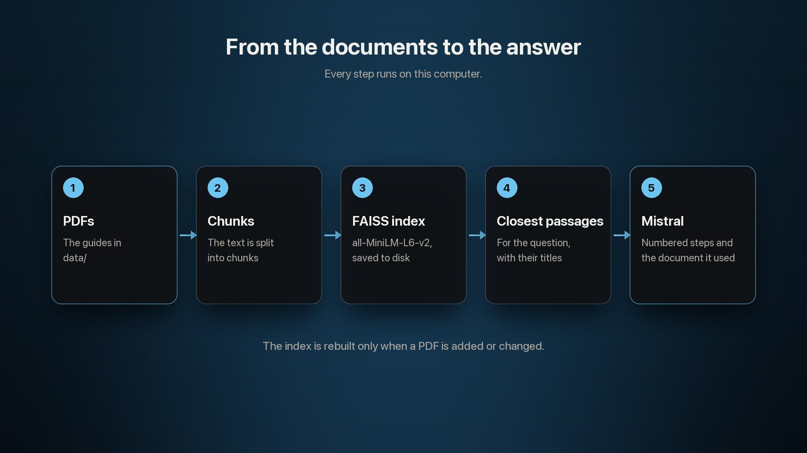

<p align="center">
  
</p>

Answers questions about official procedures in Turkey with numbered steps, taken from the documents it is given.

Python · LangChain · FAISS · Ollama (Mistral) · Flask



Ask how to get a residence certificate, register an employee with SGK, apply for citizenship or register for tax, and PolicyGPT answers with what to do, step by step, and shows which document the answer came from. It answers only from the documents: a question none of them covers, such as how to get a passport, gets "Bu konu belgelerde geçmiyor." instead of a guess.

## Screens





<details>
<summary>Full-size screenshots</summary>
<br/>


</details>

## How it works



The index is saved to disk and rebuilt only when a PDF is added or changed. For each question the closest passages go to Mistral with their document titles, and the model names the one it used, which the page shows under the answer. Mistral runs locally through Ollama, so no document or question leaves the computer.

The four PDFs in `data/` are short guides written for the project, one per topic, so the answers are only as complete and current as they are. Check anything important on the official portal.

## Running it

You need Python 3.10 or newer and [Ollama](https://ollama.com).

```bash
ollama pull mistral

git clone https://github.com/omeraydin00/PolicyGPT.git
cd PolicyGPT/PolicyGPT
python -m venv .venv && source .venv/bin/activate
pip install -r requirements.txt
python app.py
```

Then open http://127.0.0.1:5000 and pick one of the example questions, or type your own. To add a topic, put its PDF in `data/` and give it a title in `TITLES` in `rag_engine.py`. The first question takes a little longer while the embedding model loads and the index is built.

## Structure

```
PolicyGPT/
├── app.py              the Flask app: the page and the /sor endpoint
├── rag_engine.py       index, search, prompt and answer parsing
├── data/               the PDFs the answers come from
├── templates/          the page
└── static/             its styles
```

Made for the Deep Learning course at Sakarya University.
